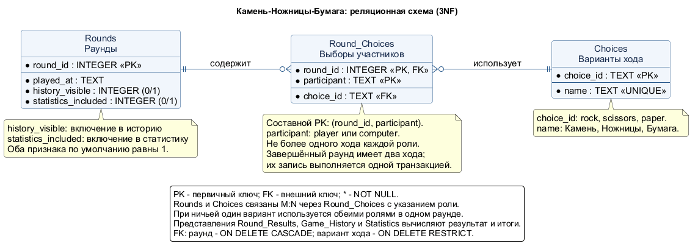

# Процесс проектирования и нормализации базы данных

## Анализ предметной области

Основание: существующее [техническое задание игры](https://github.com/maksimfrolov0413-commits/rps-statistics-2026/wiki/Техническое-задание) и лабораторная работа №4. Проектируется SQLite-схема для игры «Камень-Ножницы-Бумага со статистикой».

В текущем приложении есть пользователь и компьютер, три варианта хода, завершённые раунды, история и статистика. Регистрации, профилей, проектов, категорий и меток в требованиях игры нет, поэтому такие сущности из примера списка задач не переносятся.

Выявлены сущности:

| Сущность | Назначение | Атрибуты |
| --- | --- | --- |
| Choices | Справочник трёх вариантов хода | choice_id, name |
| Rounds | Раунд и его участие в истории и статистике | round_id, played_at, history_visible, statistics_included |
| Round_Choices | Выбор участника в конкретном раунде | round_id, participant, choice_id |

`participant` принимает только `player` или `computer`; отдельные аккаунты для этих двух ролей не нужны. `history_visible` и `statistics_included` необходимы из-за уже существующего независимого поведения кнопок «Очистить историю» и «Сбросить статистику». Это два разных состояния раунда, а не дублирование одного признака. Проектирование БД не меняет интерфейс и не подключает SQLite к браузерному прототипу.

## 1. Исходная (денормализованная) структура

Для демонстрации нормализации рассматривается учебная исходная структура:

```text
Rounds_Flat(
  round_id, played_at, history_visible, statistics_included,
  choices = [{participant, choice_id, choice_name}, ...],
  result, wins, losses, draws, total_rounds, win_rate
)
```

Это пример проблемной модели, а не таблица, существовавшая в репозитории. В `choices` хранится повторяющаяся группа двух ходов. Результат вычисляется из ходов, а показатели статистики вычисляются по совокупности раундов.

Проблемы:

- **Избыточность:** названия «Камень», «Ножницы», «Бумага» повторяются в каждом раунде; счётчики повторяются рядом с исходными данными.
- **Аномалия обновления:** изменение названия варианта требует исправления многих записей; изменение хода может оставить устаревший результат и счётчики.
- **Аномалия вставки:** без раунда негде хранить справочник доступных вариантов.
- **Аномалия удаления:** удаление последнего раунда с вариантом хода может уничтожить его описание; удаление истории может ошибочно изменить независимую статистику.

## 2. Нормализация до 1NF (Первая нормальная форма)

**Цель:** все значения атомарны, повторяющиеся группы отсутствуют.

Вместо списка ходов в одной ячейке каждый ход представлен отдельной строкой. Промежуточная таблица:

```text
Round_Choices_1NF(
  round_id, participant, choice_id, choice_name,
  played_at, history_visible, statistics_included
)
PK = (round_id, participant)
```

Например, ничья содержит две строки: `(1, player, rock, Камень, ...)` и `(1, computer, rock, Камень, ...)`. Каждая ячейка содержит одно значение. Роль участника входит в ключ: пара `(round_id, choice_id)` не подходит, поскольку при ничьей оба участника выбирают одно и то же.

Вычисляемые результат и агрегированные счётчики не копируются в базовые таблицы: для них ниже определены представления.

## 3. Нормализация до 2NF (Вторая нормальная форма)

**Цель:** устранить частичные зависимости от составного ключа.

В `Round_Choices_1NF` ключ составной — `(round_id, participant)`, но `played_at`, `history_visible`, `statistics_included` зависят только от `round_id`. Это частичная зависимость. Общие свойства раунда выносятся:

```text
Rounds(round_id PK, played_at, history_visible, statistics_included)
Round_Choices_2NF(round_id, participant, choice_id, choice_name)
PK Round_Choices_2NF = (round_id, participant)
```

В `Rounds` ключ простой. В `Round_Choices_2NF` вариант хода и его название определяются полным ключом: ни номер раунда, ни роль по отдельности не определяют ход во всех записях.

## 4. Нормализация до 3NF (Третья нормальная форма)

**Цель:** устранить транзитивные зависимости неключевых атрибутов.

В `Round_Choices_2NF` присутствует зависимость:

```text
(round_id, participant) -> choice_id -> choice_name
```

Название зависит от варианта хода, а не непосредственно от ключа строки выбора. Создаётся `Choices(choice_id PK, name UNIQUE NOT NULL)`, а `choice_name` удаляется из таблицы выборов. Там остаётся только внешний ключ `choice_id`.

Функциональные зависимости итоговых таблиц:

- `Choices`: `choice_id -> name`; `name` также является кандидатным ключом благодаря UNIQUE и NOT NULL.
- `Rounds`: `round_id -> played_at, history_visible, statistics_included`.
- `Round_Choices`: `(round_id, participant) -> choice_id`.

Все атрибуты атомарны, частичных и транзитивных зависимостей неключевых атрибутов нет. Базовые таблицы находятся в 3NF. Зависимость даты или признаков раунда от выбора не предполагается.

`result` вычисляется по классическим правилам в представлении `Round_Results`. `Statistics` вычисляет победы, поражения, ничьи, число раундов и процент побед по раундам с `statistics_included = 1`. При отсутствии раундов процент равен 0. Это представления запросов, а не дополнительные таблицы с дублируемыми итогами.

## 5. Реализация связей «Многие-ко-многим» (M:N)

В разных раундах используются разные варианты, а каждый вариант используется во многих раундах. Связь `Rounds` и `Choices` реализована через `Round_Choices` с дополнительным атрибутом роли:

```text
Rounds 1 : N Round_Choices
Choices 1 : N Round_Choices
Round_Choices PK = (round_id, participant)
```

Один раунд допускает не более двух строк выбора, по одной для каждой роли. Один вариант может использоваться в обеих строках одного раунда — это ничья. Поэтому уникальность `(round_id, choice_id)` намеренно не задаётся. В таблице связей нет названий ходов и других неключевых описательных атрибутов.

Завершённый раунд должен иметь оба хода. DDL ограничивает допустимые роли и не допускает дублирования роли, но сам по себе не требует наличия обеих строк: при будущей интеграции номер раунда и оба хода нужно записывать одной транзакцией. `Round_Results` включает только раунды с обоими ходами. В `seed_data.sql` все раунды завершены.

## 6. Финальная схема



Форматы: [SVG](../docs/database/er_diagram.svg), [исходник PlantUML](../docs/database/er_diagram.puml).

```text
Choices(choice_id PK, name UNIQUE)
Rounds(round_id PK, played_at, history_visible, statistics_included)
Round_Choices(round_id PK/FK, participant PK, choice_id FK)
```

Внешние ключи:

- `Round_Choices.round_id -> Rounds.round_id`, ON DELETE CASCADE: физическое удаление раунда удаляет связанные ходы.
- `Round_Choices.choice_id -> Choices.choice_id`, ON DELETE RESTRICT: использованный вариант нельзя удалить из справочника.

Для составного первичного ключа оба столбца явно объявлены NOT NULL. CHECK ограничивает три кода ходов, две роли и булевы признаки. Включение FK выполняется командой `PRAGMA foreign_keys = ON` перед транзакцией; при работе с SQLite это требуется для каждого подключения.

Индексы:

- `idx_rounds_history` — выборка видимой истории по дате и номеру.
- `idx_rounds_statistics` — выборка раундов, участвующих в статистике.
- `idx_round_choices_choice_id` — поиск использований варианта и проверка его FK при удалении.
- Первичный ключ `(round_id, participant)` уже индексирует ходы по номеру раунда; отдельный индекс на `round_id` не дублируется.

### Соответствие существующим действиям игры

| Действие | Операция над моделью |
| --- | --- |
| Новый раунд | INSERT в Rounds и две строки Round_Choices в одной транзакции |
| Просмотр результата | SELECT из Round_Results |
| Просмотр истории | SELECT из Game_History с сортировкой по played_at DESC, round_id DESC |
| Очистить историю | UPDATE Rounds SET history_visible = 0 |
| Сбросить статистику | UPDATE Rounds SET statistics_included = 0 |
| Начать заново | DELETE FROM Rounds; ходы удалятся каскадно, справочник сохранится |

После независимой очистки данные раундов остаются источником для второй функции, поэтому скрытие истории не должно физически удалять раунды. Новые раунды по умолчанию видимы и учитываются в статистике. Сброс номера AUTOINCREMENT не требуется: идентификатор БД — технический ключ, а не отображаемый счётчик новой игры.

### SQL-скрипты и тестовые данные

- [schema.sql](schema.sql) — таблицы, ограничения, индексы и вычисляемые представления.
- [seed_data.sql](seed_data.sql) — три варианта и девять учебных раундов, покрывающих все сочетания ходов.

Тестовые данные вымышленные и не являются историей пользователя. Ожидаемые итоги: 3 победы пользователя, 3 победы компьютера, 3 ничьи, 9 раундов, процент побед около 33.3333%.

### Справочные материалы

- [SQLite: внешние ключи](https://www.sqlite.org/foreignkeys.html).
- [SQLite: CREATE TABLE](https://www.sqlite.org/lang_createtable.html).
- [PlantUML: ER-диаграммы](https://plantuml.com/ie-diagram).
