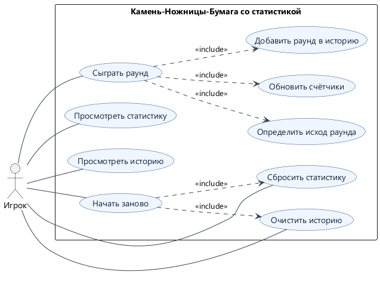
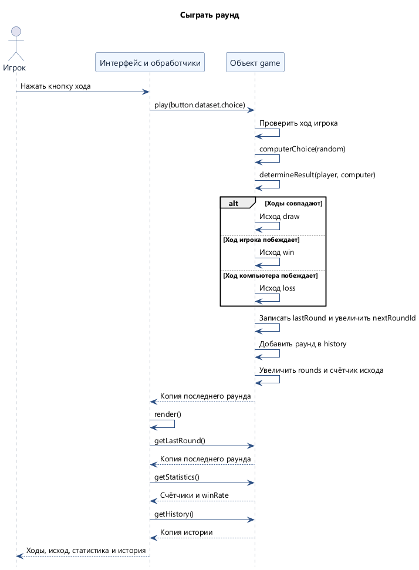
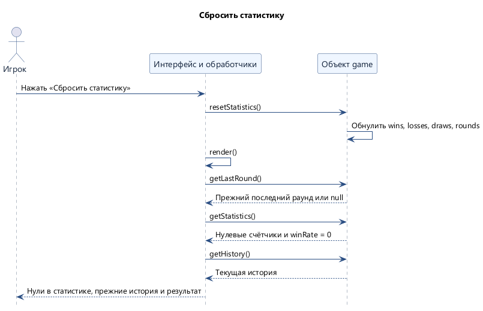
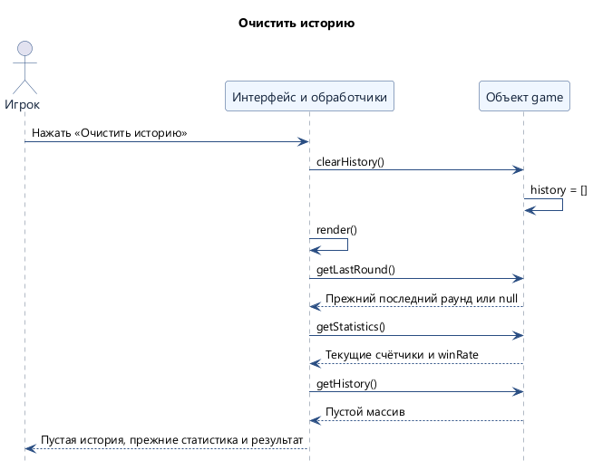
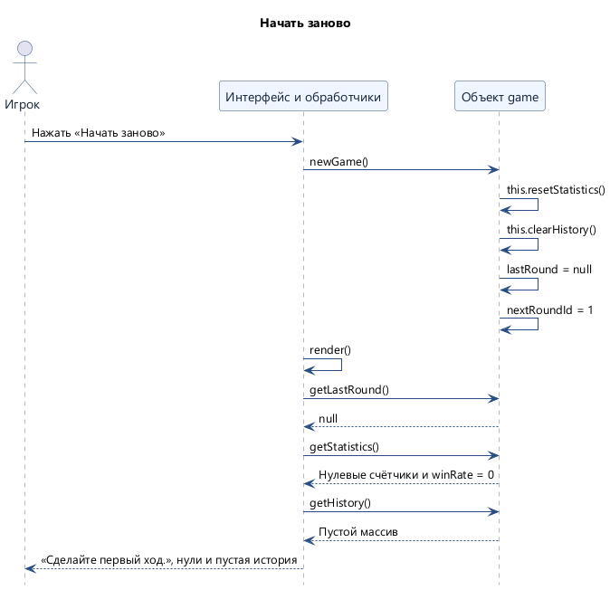

# Лабораторная работа №5. Моделирование поведения

Цель работы — описать поведение игры «Камень–Ножницы–Бумага со статистикой» с помощью UML. Use Case показывает действия игрока, а четыре диаграммы последовательности раскрывают обработку раунда и трёх команд управления состоянием.

Интерфейс реализован в [index.html](../../index.html), игровая логика и отрисовка — в [script.js](../../script.js). Состояние игры хранится в памяти страницы. [Проект SQLite из лабораторной №4](../../database/normalization.md) описывает отдельную модель хранения.

## Use Case

Актор «Игрок» выбирает ход, просматривает статистику и историю, сбрасывает счётчики, очищает историю и может начать заново. Статистика и история видны прямо на странице. Связи `«include»` показывают обязательные действия в составе раунда и полного сброса. Случайный ход компьютера генерирует сама игра.

[Исходник PlantUML](../use_case/use_case_diagram.puml)

## Сыграть раунд

Нажатие «Камень», «Ножницы» или «Бумага» вызывает `play()`. Метод выбирает ход компьютера, определяет победу, поражение или ничью, сохраняет раунд в памяти и обновляет счётчики. После `render()` видны оба хода, исход, новая статистика и история от последнего раунда к первому.

[Исходник PlantUML](sequence/play_round_sequence.puml)

## Сбросить статистику

Кнопка вызывает `resetStatistics()`. Победы, поражения, ничьи, количество раундов и отображаемый процент побед становятся нулевыми. История, последний результат и последовательность номеров раундов сохраняются.

[Исходник PlantUML](sequence/reset_statistics_sequence.puml)

## Очистить историю

Кнопка вызывает `clearHistory()`. Игра показывает сообщение «История пока пуста.» Статистика, последний результат и последовательность номеров раундов сохраняются.

[Исходник PlantUML](sequence/clear_history_sequence.puml)

## Начать заново

Кнопка вызывает `newGame()`, который обнуляет статистику и очищает историю. Метод сбрасывает последний раунд и устанавливает номер следующего раунда равным 1. Интерфейс показывает начальное состояние.

[Исходник PlantUML](sequence/new_game_sequence.puml)

## Проверка в браузере

| Действие | Ожидаемый результат |
| --- | --- |
| Открыть `index.html` и сыграть два раунда | Отображается результат второго раунда, всего два раунда, в истории две строки. Строка второго раунда стоит первой. |
| Нажать «Сбросить статистику» | Все показатели равны нулю, видны обе строки истории и последний результат. |
| Сыграть ещё один раунд | Статистика показывает один раунд, в истории три строки, сверху раунд №3. |
| Нажать «Очистить историю» | История пуста, статистика показывает один раунд, последний результат виден. |
| Нажать «Начать заново», затем сделать ход | До хода все показатели равны нулю, история пуста, отображается приглашение сделать первый ход. После хода появляется раунд №1. |

Диаграммы подготовлены в PlantUML и экспортированы в PNG.
